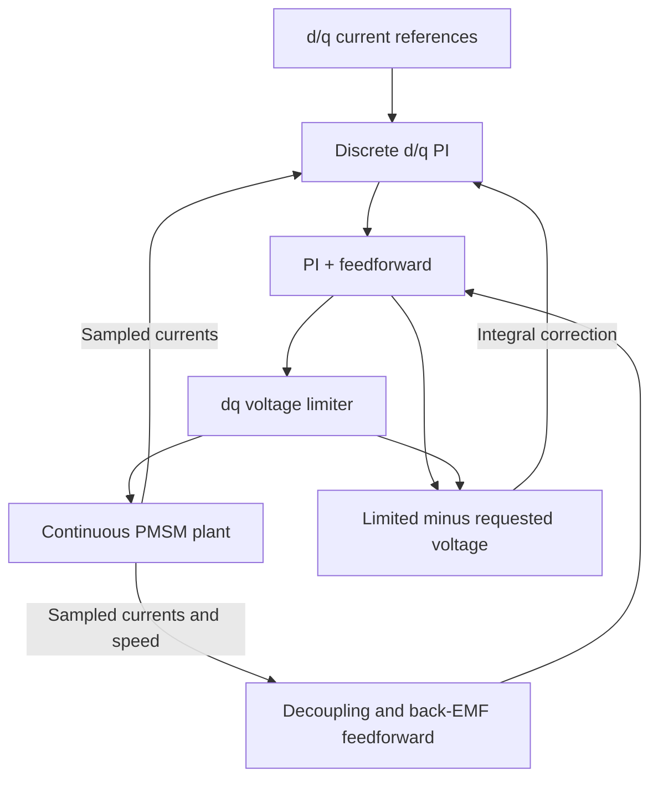

# PMSM Model-Based Development

This folder contains the Simulink side of the [C2000 motor-control project](../../README.md). I use it to check the motor equations, develop the controller, and understand its behavior before moving the algorithm onto the board.

The current model covers the dq current loop, including discrete PI control, decoupling feedforward, voltage limiting, and anti-windup. Speed control is the next step. Code generation and SIL/PIL testing are still planned.

## Files and model structure

| Location | Contents |
| --- | --- |
| [MotorControlMBD.prj](MotorControlMBD.prj) | MATLAB project |
| [models/plant](models/plant) | Continuous, equation-based motor plant |
| [models/controller](models/controller) | Continuous baselines and discrete current controllers |
| [scripts](scripts) | Motor parameters and controller initialization |
| [tests](tests) | Open-loop and closed-loop simulation testbenches |

The main files for the current work are [lvservomtr_dq_plant.slx](models/plant/lvservomtr_dq_plant.slx), [dq_current_controller_discrete.slx](models/controller/dq_current_controller_discrete.slx), and [tb_current_antiwindup_recovery.slx](tests/tb_current_antiwindup_recovery.slx). Earlier models remain available for comparing the continuous and discrete implementations.

The plant and controller are separate referenced models. Testbench blocks supply the references and load torque, sample the feedback, and collect the signals used for comparison.



## Plant and parameters

The plant takes `vd`, `vq`, and load torque as inputs and returns d/q currents, electromagnetic torque, and mechanical speed. Electrical speed is obtained from mechanical speed using the pole-pair count: `ωe = p × ωm`.

The current setup uses equal d/q inductances, so torque is proportional to q-axis current:

$$
T_e=\frac{3}{2}p\psi_{PM}i_q,\qquad
J\frac{d\omega_m}{dt}=T_e-T_{load}-B\omega_m
$$

| Parameter | Current value |
| --- | --- |
| Pole pairs | 4 |
| Phase resistance | 0.36 Ω |
| d/q inductance | 200 µH / 200 µH |
| PM flux linkage | 6.40 mWb |
| Rotor inertia | 7.0616 × 10⁻⁶ kg·m² |
| Viscous friction | 0 N·m·s/rad |
| Current-control sample time | 50 µs / 20 kHz |
| Nominal current-loop bandwidth | 1 kHz |
| Simulation DC bus | 12 V |

Motor values and conversions are in [init_lvservomtr.m](scripts/init_lvservomtr.m). Controller settings are in [init_current_control.m](scripts/init_current_control.m). The bus voltage and bandwidth are experiment settings.

This is an averaged dq model. It does not currently include PWM switching, inverter dead time, sensor noise, or DC-bus energy dynamics. With zero friction and zero load, steady speed requires zero torque; torque is still needed during acceleration.

## Current controller

The plant evolves continuously while the controller updates every 50 µs. Zero-Order Hold blocks sample the feedback at this rate. Controller sample time and the testbench's solver configuration are separate settings.

For each axis, the initial PI tuning uses the electrical RL model:

$$
K_p=L\omega_c,\qquad K_i=R_s\omega_c,\qquad \omega_c=2\pi f_c
$$

The discrete integral uses Forward Euler. Feedforward adds the voltage terms needed to compensate dq coupling and permanent-magnet back-EMF:

$$
v_d^{FF}=-\omega_e L_q i_q,\qquad
v_q^{FF}=\omega_e(L_d i_d+\psi_{PM})
$$

The voltage limiter scales both components together, preserving the requested vector direction within the linear SVPWM boundary. At a 12 V bus, its magnitude limit is approximately 6.928 V:

$$
\sqrt{v_d^2+v_q^2}\le V_{DC}/\sqrt{3}
$$

Back-calculation uses the difference between the limited voltage and the raw PI-plus-feedforward request to correct each integral state:

$$
x_I[k+1]=x_I[k]+T_s\left(K_i e[k]+K_{aw}(v^{limited}[k]-v^{raw}[k])\right)
$$

Here, `e` is reference minus measured current and `xI` is the integral contribution in volts. The initialization script sets `Kaw = Ki/Kp`; `control.antiWindupEnable` switches the correction on or off.

## Running a simulation

The current discrete controller and recovery testbench are saved in R2025b. MATLAB and Simulink are sufficient for these equation-based simulations.

From the repository root in MATLAB:

```matlab
mbdProject = openProject("12_models/mbd/MotorControlMBD.prj");
mbdRoot = mbdProject.RootFolder;

addpath(fullfile(mbdRoot, "models", "plant"), ...
        fullfile(mbdRoot, "models", "controller"), ...
        fullfile(mbdRoot, "tests"));

run(fullfile(mbdRoot, "scripts", "init_lvservomtr.m"));
run(fullfile(mbdRoot, "scripts", "init_current_control.m"));

open_system("tb_current_antiwindup_recovery");
```

For the anti-windup comparison:

1. Set `control.antiWindupEnable = 0` and run for 0.08 s.
2. Set it to `1` and repeat from the same initial conditions.
3. Compare the current reference, `iq_A`, `vqIntegral_V`, and limited voltage in Simulation Data Inspector.

The q-axis reference changes to +2 A at 5 ms, then to −2 A at 40 ms, after voltage saturation has occurred. Without anti-windup, the stored integral delays current reversal. With anti-windup enabled, that delay is substantially reduced. Running the controller initialization script again restores the default enabled setting.

## Verification and next steps

The model-level experiments so far cover open-loop behavior, P versus PI tracking, decoupling, discretization, voltage saturation, and anti-windup recovery. These simulations form the current MIL work; generated-code and target comparisons have not been completed.

The next steps are:

1. Add the speed loop and check reference tracking and load-disturbance rejection.
2. Generate controller C code and compare it with the model in SIL.
3. Run PIL on the C2000 to compare numerical behavior and measure execution time.
4. Integrate the controller with real current measurements, encoder feedback, coordinate transforms, and PWM generation.

Track `.slx` models, initialization scripts, testbench sources, and MATLAB project metadata in Git. Simulink caches (`*.slxc`, `slprj/`) are regenerated locally and are excluded by the repository's `.gitignore`.
