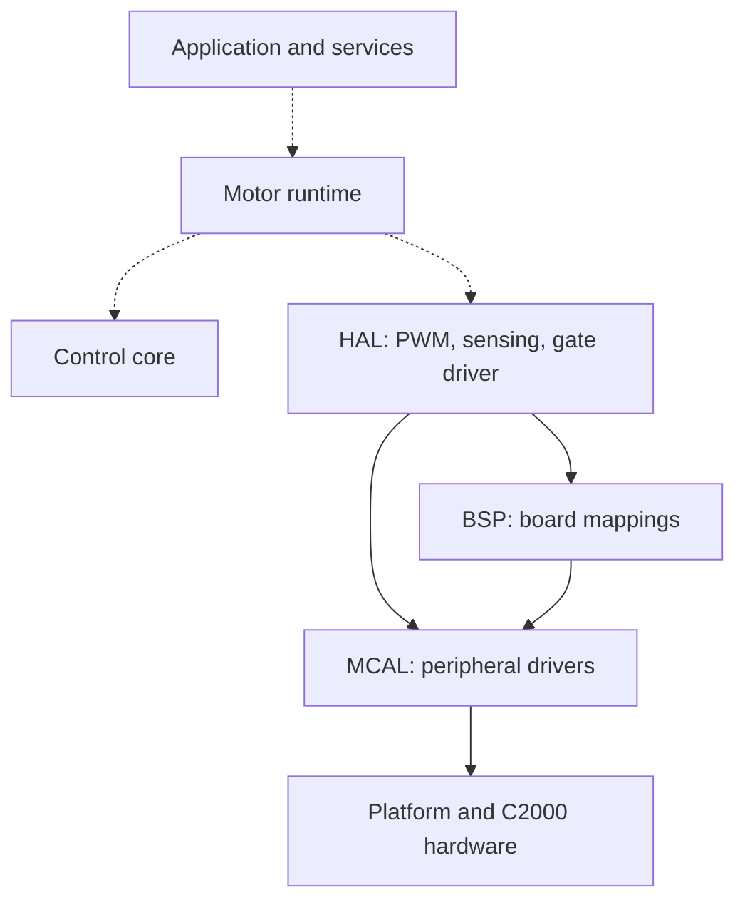

# C2000 Motor Control

I am building a PMSM drive on the TI TMS320F28379D, from peripheral drivers to a complete field-oriented control application. This repository contains the embedded C/C++ code, board-level tests, and Simulink models used to develop the controller before running it on the motor.

The work currently focuses on discrete current control in Simulink and the PWM, current-sensing, and gate-driver interfaces on the C2000. Closing the motor-control loop on hardware is still ahead.
For the models, parameters, and simulation instructions, see the [MBD README](12_models/mbd/README.md).

## Hardware and tools

- **Controller:** LAUNCHXL-F28379D, using CPU1.
- **Intended drive setup:** BOOSTXL-DRV8305-EVM and TI LVSERVOMTR (Teknic M-2310P-LN-04K).
- **Firmware:** Code Composer Studio, TI C2000 Compiler, and C2000Ware; C for peripheral drivers and the fast current-conversion path, C++ for HAL components.
- **Modeling:** MATLAB/Simulink R2025b. Simulink Coder and Embedded Coder will be used for the code-generation stage.

## Architecture

MCAL handles peripheral access, BSP defines the board mappings, and HAL provides interfaces for motor PWM, current measurements, and the gate driver. The control core will hold the control calculations; the runtime will manage their execution and motor operating states.

Dashed connections show the layers awaiting integration.

| Location | Purpose |
| --- | --- |
| `00_platform`, `01_mcal`, `02_bsp` | Device setup, peripheral drivers, and board configuration |
| `03_hal` | Motor PWM, current sensing, and DRV8305 interfaces |
| `04_control`, `05_motor_runtime` | Reserved for target-side control and its execution |
| `06_services`, `07_application` | Reserved for diagnostics, communication, and application behavior |
| `08_labs`, `09_tests` | Experiments and board-level tests |
| `10_docs`, `11_tools`, `12_models` | Documentation, development tools, and simulation models |

## Progress

- Platform and peripheral APIs are implemented, along with HAL components for PWM, current sensing, and DRV8305 configuration and fault reporting.
- Current-sense calibration and PWM-synchronized ADC timing have documented bench results. These tests use a potentiometer input or run without the inverter connected.
- The Simulink current controller includes discrete PI control, decoupling feedforward, voltage limiting, and back-calculation anti-windup. Current reversal has been used to compare recovery with and without anti-windup.

The next steps are speed control and load-disturbance tests, followed by generated-code comparison in SIL/PIL and C2000 integration. Encoder feedback, coordinate transforms, and SVPWM will connect the controller to the real drive. CLA execution and application scheduling come later.

